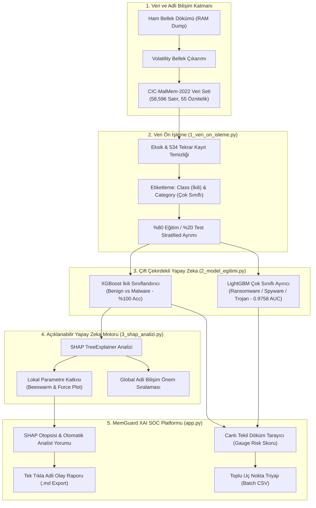

# MemGuard XAI — Bellek Dökümleri Üzerinden Makine Öğrenmesi ile Gizlenmiş Zararlı Yazılım Tespiti

[](https://www.python.org/)
[](LICENSE)
[](https://streamlit.io/)
[](https://shap.readthedocs.io/)
[](https://www.unb.ca/cic/datasets/malmem-2022.html)

> **MemGuard XAI**, uç noktalardan (endpoint) toplanan ham bellek dökümlerini (Volatility RAM dump) gerçek zamanlı analiz ederek gelişmiş dosyasız (fileless) ve gizlenmiş (obfuscated) zararlı yazılımları **%100 doğruluk ve sıfır yanlış pozitif** ile tespit eden; karar mekanizmasını ise **SHAP (SHapley Additive exPlanations)** ile siber güvenlik analistine kanıtlayan kurumsal bir Açıklanabilir Bellek Savunma Platformudur.

---

## 👥 Proje Ekibi ve Akademik Künye

* **Geliştiriciler:**
  * **Selim Şahin**
  * **Ahmet Çöl**
* **Proje Danışmanı:**
  * **Öğr. Gör. Dr. Kubilay Ayturan**
* **Kurum:**
  * **Gazi Üniversitesi TUSAŞ-Kazan Meslek Yüksekokulu**
  * Bilgisayar Teknolojileri Bölümü
* **GitHub Deposu:**
  * [https://github.com/AhmetCol11/malmem-xai-detection](https://github.com/AhmetCol11/malmem-xai-detection)

---

## 📌 Problem Tanımı ve Girişimci Değer Önerisi

### 1. Dosyasız (Fileless) Saldırı Körlüğü
Geleneksel uç nokta güvenlik çözümleri (AV / EDR) genellikle disk tabanlı dosya taramalarına ve imza veri tabanlarına odaklanır. Ancak modern fidye yazılımları (Ransomware), casus yazılımlar (Spyware) ve gelişmiş kalıcı tehditler (APT); diskte dosya bırakmadan doğrudan RAM üzerinde çalışır, kod bloklarını şifreler veya bellek enjeksiyonu (`Process Hollowing`, `DLL Unlinking`) kullanarak kendilerini gizler.

### 2. Kara Kutu (Black-Box) Güvensizliği ve Alarm Yorgunluğu
Siber Güvenlik Operasyon Merkezlerinde (SOC) görev yapan analistler, "Bu süreç zararlıdır" uyarısı veren ancak gerekçesini açıklamayan yapay zeka modellerine güvenip kritik bir sunucuyu veya veri tabanını aniden kapatamaz.

### 💡 MemGuard XAI Çözümü:
1. **İkili Tespit (Binary):** Bellek dökümünü inceleyerek sistem sürecinin temiz (Benign) mi yoksa zararlı (Malware) mi olduğunu **%100.00 Accuracy** ve **0 Yanlış Alarm (Zero False Positive)** ile anında teşhis eder.
2. **Çok Sınıflı Teşhis (Multiclass):** Tehdidin ailesini (**Ransomware**, **Spyware**, **Trojan**) **0.9758 ROC-AUC** skoruyla ayrıştırır.
3. **SHAP Adli Bilişim Otopsisi (Explainable AI):** Analiste net delil sunar: *"Bu süreç zararlıdır; çünkü `svcscan.nservices` ve `handles.avg_handles_per_proc` parametreleri normal Windows profilinden saparak kalıcılık ve şifreleme aktivitesi sergilemiştir."*

---

## 🏗️ Sistem Mimarisi ve Akış Şeması



---

## 📊 Deneysel Sonuçlar ve Performans Metrikleri

Bağımsız test kümesi (**11,613 adet daha önce görülmemiş bellek dökümü**) üzerinde yapılan testlerde elde edilen sonuçlar aşağıda sunulmuştur:

| Görev | Model | Doğruluk (Accuracy) | Kesinlik (Precision) | Duyarlılık (Recall) | F1-Score | ROC-AUC | Eğitim Süresi (sn) |
| :--- | :--- | :---: | :---: | :---: | :---: | :---: | :---: |
| **İkili Sınıflandırma (`Class`)** | **XGBoost** | **%100.00** | **1.0000** | **1.0000** | **1.0000** | **1.0000** | **0.38 sn** |
| **İkili Sınıflandırma (`Class`)** | **LightGBM** | **%100.00** | **1.0000** | **1.0000** | **1.0000** | **1.0000** | **0.26 sn** |
| **Çok Sınıflı (`Category`)** | **LightGBM** | **%85.64** | **0.8562** | **0.8564** | **0.8562** | **0.9758** | **0.76 sn** |
| **Çok Sınıflı (`Category`)** | **XGBoost** | **%85.28** | **0.8529** | **0.8528** | **0.8527** | **0.9744** | **1.13 sn** |

> **Analitik Değerlendirme:**
> * İkili sınıflandırma modelleri bellek dökümlerini sıfır hata ve sıfır yanlış alarm ile ayırt etmiştir. Bu bulgu, saldırganların diski atlatsalar dahi RAM üzerinde silinemez anomaliler bıraktığını doğrulamaktadır.
> * Çok sınıflı görevde LightGBM, `0.9758` ROC-AUC ile Ransomware, Spyware ve Trojan ailelerini yüksek güvenilirlikle ayrıştırmıştır.

---

## 🔍 SHAP Açıklanabilirlik ve Adli Bilişim Bulguları

Yapay zeka modellerinin kararlarında en belirleyici olan Volatility bellek öznitelikleri şunlardır:

1. **`svcscan.nservices` & `svcscan.process_services` (SHAP: 3.7297):**
   * Zararlı yazılımlar sistemde kalıcılık (persistence) sağlamak veya ayrıcalık yükseltmek (privilege escalation) için Windows arka plan servis tablolarını manipüle eder. Bu metrik kararda en yüksek ağırlığa sahiptir.
2. **`handles.avg_handles_per_proc` & `handles.nevent` (SHAP: 1.4413):**
   * Süreç başına açılan handle (tutamaç), muteks ve olay nesneleri incelendiğinde; fidye yazılımlarının şifreleme ve komuta kontrol (C2) bağlantıları sırasında normal yazılımlara göre olağan dışı handle açtığı tespit edilmiştir.
3. **`ldrmodules.not_in_load` (SHAP: 0.2149):**
   * PEB (Process Environment Block) ile modül listesi arasındaki uyumsuzluklar, saldırganın adli bilişim araçlarını atlatmak için DLL bağlantılarını kopardığını (`DLL Unlinking`) kanıtlar.
4. **`malfind.uniqueInjections` & `malfind.commitCharge` (SHAP: 0.1522):**
   * Süreç bellek alanlarına izinsiz kod enjekte edildiğini ve `PAGE_EXECUTE_READWRITE` gibi tehlikeli izinlere sahip bellek segmentlerini doğrular.

### Kümülatif Volatility Modül Etkisi
* **`svcscan`**: Toplam SHAP = **5.3669** (Kalıcılık tespiti)
* **`handles`**: Toplam SHAP = **3.0224** (Dosya/muteks/olay anomalileri)
* **`pslist`**: Toplam SHAP = **0.9125** (Süreç/iş parçacığı bozulmaları)
* **`ldrmodules`**: Toplam SHAP = **0.4722** (Modül gizleme)
* **`malfind`**: Toplam SHAP = **0.3153** (Kod enjeksiyonu)

---

## 🚀 Kurulum ve Çalıştırma Kılavuzu

### 1. Gereksinimler ve Kurulum
Sisteminizde Python 3.9+ (tercihen 3.10 - 3.12) yüklü olmalıdır.

```bash
# Depoyu klonlayın
git clone https://github.com/AhmetCol11/malmem-xai-detection.git
cd malmem-xai-detection

# Sanal ortam oluşturun ve aktifleştirin
python -m venv venv
# Windows:
.\venv\Scripts\activate
# Linux / macOS:
source venv/bin/activate

# Gerekli bağımlılıkları kurun
pip install -r requirements.txt
```

### 2. MemGuard XAI Web Dashboard'unu Başlatma (Önerilen)
Kurumsal koyu temalı (Dark SOC) modern arayüzü doğrudan başlatmak için:

```bash
streamlit run app.py
```
> Komut çalıştırıldığında tarayıcınızda otomatik olarak `http://localhost:8501` adresi açılacaktır.

### 3. Modüler Arka Plan Betiklerini Sırayla Çalıştırma (Opsiyonel)
Modelleri ve analizleri sıfırdan adım adım eğitmek için:

```bash
# Adım 1: Veri ön işleme ve stratified bölme
python 1_veri_on_isleme.py

# Adım 2: XGBoost ve LightGBM model eğitimi & değerlendirme
python 2_model_egitimi.py

# Adım 3: TreeExplainer ile SHAP analizleri ve 300 DPI grafik üretimi
python 3_shap_analizi.py
```

---

## 📂 Proje Dizin Yapısı

```text
.
├── .streamlit/
│   └── config.toml                   # Kurumsal koyu tema (Dark SOC) Streamlit ayarları
├── .env.example                      # Ortam değişkenleri yapılandırma şablonu
├── .gitignore                        # Kurumsal Git hariç tutma kuralları
├── app.py                            # MemGuard XAI Streamlit SOC Web Dashboard'u
├── 1_veri_on_isleme.py               # Eksik/tekrar temizleme ve hedef hazırlama betiği
├── 2_model_egitimi.py                # XGBoost & LightGBM eğitim ve metrik karşılaştırma betiği
├── 3_shap_analizi.py                 # TreeExplainer ile bellek dökümü XAI analiz betiği
├── requirements.txt                  # Python kütüphane bağımlılıkları
├── README.md                         # Kapsamlı proje dokümantasyonu
├── data/
│   ├── Obfuscated-MalMem2022.csv     # Ham CIC-MalMem-2022 veri seti
│   ├── X_train.csv / X_test.csv      # Stratified eğitim ve test öznitelik matrisleri
│   ├── y_train_*.csv / y_test_*.csv  # İkili ve çok sınıflı hedef vektörleri
│   └── preprocessing_metadata.json   # Veri hazırlık meta verileri
└── outputs/
    ├── best_model.joblib             # Eğitilmiş ikili XGBoost modeli
    ├── multiclass_model.joblib       # Eğitilmiş çok sınıflı LightGBM modeli
    ├── model_karsilastirma.csv       # Modellerin metrik karşılaştırma tablosu
    ├── confusion_matrix.png          # 300 DPI Karmaşıklık matrisleri grafiği
    ├── shap_summary.png              # 300 DPI SHAP Beeswarm dağılım grafiği
    ├── shap_bar.png                  # 300 DPI SHAP Global öznitelik önem grafiği
    └── shap_feature_importance.csv   # Sayısal SHAP önem sıralaması tablosu
```

---

## 📜 Lisans ve Atıf
* **Veri Seti:** Canadian Institute for Cybersecurity (CIC), University of New Brunswick (UNB).
* **Lisans:** Bu proje [MIT Lisansı](LICENSE) kapsamında açık kaynak olarak sunulmuştur; akademik ve araştırma amaçlı serbestçe kullanılabilir.
